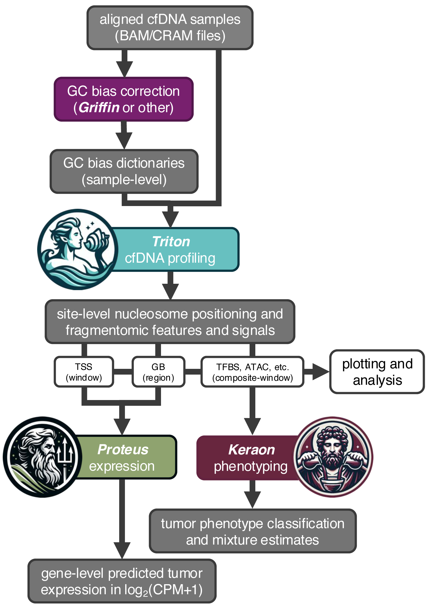

# Proteus 

**Predicting gene expression from cell-free DNA fragmentomics with deep mixture density networks.**

Proteus is a PyTorch-based deep learning pipeline that predicts per-gene mRNA abundance
(log₂(CPM + 1)) directly from whole-genome sequencing of cell-free DNA (cfDNA).
It takes Triton V2 signal profiles — promoter-region coverage, nucleosome positioning,
and fragmentation features — and produces full predictive distributions for every gene,
providing a liquid-biopsy analog to traditional RNA-seq.

*Proteus, the prophetic "old man of the sea," would change form before ultimately
revealing the truth. Like Proteus, this tool transforms cfDNA data to reveal the
expression landscape hidden within.*
<br clear="all"/>

## The Pantheon

Proteus is part of **The Pantheon** — a suite of cfDNA processing and analysis
tools. [Triton](https://github.com/denniepatton/Triton) generates bp-resolution
fragmentomic and nucleosome signal profiles from cfDNA BAM/CRAM files. Proteus
consumes these profiles to predict tumor gene expression, while
[Keraon](https://github.com/denniepatton/Keraon) uses them to predict tumor
subtypes and their proportions.



## Architecture

The core model is **BioDVN** (Biologically-informed Disentangling Variational Network):
a CNN + dual-encoder VAE with Mixture Density Network (MDN) output heads.

```
Inputs
  TSS signals  (2000 bp × 8 channels)  ─┐
  TSS nucleotides (2000 bp × 4)         ├─→ SignalProcessingBlock (grouped Conv1D + Conv2D)
                                         ┘         │
                               Dual-dilation ReductionBlocks + AvgPool
                                                   │
                                       Signal Encoder (conv → 64-d)
                                                   │
                               concat with TSS features (11) + GB features (11)
                               + reference scalars (3)
                                                   │
                           ┌── Tumor VAE Encoder ──→ z_tumor ──┐
                           └── Background VAE Encoder ──→ z_bg ─┤
                                                                │
                               TFX Discriminator (GRL) ← z_tumor (adversarial)
                               Weight Predictor → α (TFX-conditioned mixing)
                               MergeLatents(z_tumor, z_bg, α) → Decoder
                                                                │
                           ┌── MDN Head (tumor) ──→ {π, β_gamma, μ_normal, σ_normal}
                           └── MDN Head (background) ──→ {π, β_gamma, μ_normal, σ_normal}
```

Each MDN head outputs a **3-component mixture distribution**:
1. **Delta-zero** — point mass at 0 for unexpressed genes
2. **Gamma(k=0.80, β)** — right-skewed component for low expression
3. **Normal(μ, σ²)** — symmetric component for moderate/high expression

The model is trained to minimize **CRPS** (Continuous Ranked Probability Score) rather
than MSE, producing calibrated uncertainty estimates alongside point predictions.

## Input Data

Proteus consumes per-gene features generated by
[Triton V2](https://github.com/denniepatton/Triton):

| Input | Shape | Description |
|---|---|---|
| TSS signals | (2000, 8) | Coverage, fragment-end coverage/asymmetry, P/N signal, FL sub-nuc ratio, FL entropy, FL Gini-Simpson, P/N peaks |
| TSS nucleotides | (2000, 4) | A/C/G/T one-hot encoding of the reference sequence |
| TSS features | (11,) | Summary statistics: fragment length moments, nucleosome metrics, depth |
| GB features | (11,) | Gene-body summary statistics (identical feature set to TSS) |
| Reference scalars | (3,) | Gene-level reference annotations |

Raw Triton outputs are compiled into per-sample **Zarr stores** via `--process_data`.

## Preparing Inputs with Triton

Proteus requires per-sample outputs from
[Triton V2](https://github.com/denniepatton/Triton), run in **window mode** for
promoter regions (TSS) and **region mode** for gene bodies (GB). Each run
produces signal profiles (`.npz`) and region-level features (`.tsv`) per sample.

### GC Bias Correction

Triton applies fragment-level GC bias correction to all analyses (coverage,
fragment length distributions, and derived metrics). This requires a
per-sample `.GC_bias` file generated by
[Griffin](https://github.com/GavinHaLab/Griffin) or an equivalent tool.
GC correction is critical for accurate downstream predictions — uncorrected
profiles introduce systematic biases that propagate through Proteus.

### Running Triton

```bash
# TSS (promoter) profiles — window mode, ±1000 bp around each TSS
python3 Triton/Triton.py \
    --sample_name SAMPLE_ID \
    --input /path/to/sample.bam \
    --bias /path/to/sample.GC_bias \
    --annotation config/site_lists/MANE.GRCh38.v1.3_TSS.bed \
    --reference_genome /path/to/genome.fa \
    --results_dir triton_output/TSS/results \
    --run_mode window

# Gene-body profiles — region mode, full gene bodies
python3 Triton/Triton.py \
    --sample_name SAMPLE_ID \
    --input /path/to/sample.bam \
    --bias /path/to/sample.GC_bias \
    --annotation config/site_lists/MANE.GRCh38.v1.3_TranscriptBodies.bed \
    --reference_genome /path/to/genome.fa \
    --results_dir triton_output/GB/results \
    --run_mode region
```

For large cohorts, use Triton's Snakemake workflow for parallelized execution
(see the [Triton README](https://github.com/denniepatton/Triton) for details).

Once Triton outputs are available, point your dataset YAML config at the results
directories and run `--process_data` to compile them into Zarr stores.

## Quick Start

### Environment Setup

Proteus uses a micromamba environment with PyTorch + CUDA 12.1 bundled:

```bash
micromamba create -n proteus -c pytorch -c nvidia \
    python=3.10 pytorch torchvision torchaudio pytorch-cuda=12.1
micromamba activate proteus
pip install zarr numcodecs numpy pandas h5py optuna matplotlib seaborn scipy scikit-learn pyyaml rich
```

No separate CUDA/cuDNN module loads are required — the conda environment bundles
the full CUDA 12.1 runtime. Only the host NVIDIA driver (≥ 530) is needed.

### Data Preparation

```bash
# Compile Triton outputs → Zarr stores
python Proteus.py --process_data --use_set PC-PDX

# Verify Zarr stores
python Proteus.py --verify_data --use_set PC-PDX

# Generate cross-validation fold indices
python Proteus.py --generate_folds --use_set PC-PDX
```

### Training

```bash
# Cross-validation (all folds)
python Proteus.py --run_mode train --experiment config/experiments/biodvn_train.yaml

# Single fold (for HPC parallelization)
python Proteus.py --run_mode train --experiment config/experiments/biodvn_train.yaml --test_fold 1

# Full-train (production model, all data)
python Proteus.py --run_mode full-train --experiment config/experiments/biodvn_train.yaml
```

### Hyperparameter Tuning

```bash
# Optuna tuning (fold-parallel with shared SQLite DB)
python Proteus.py --run_mode tune --experiment config/experiments/biodvn_tune_phase2-2.yaml --test_fold 1

# Sequential CV tuning (single process)
python Proteus.py --run_mode tune --experiment config/experiments/biodvn_tune_phase2-2.yaml --n_trials 50
```

### Inference

```bash
python Proteus.py --run_mode run --model_name BioDVN --use_set <dataset>
```

## CLI Reference

| Argument | Description |
|---|---|
| `--process_data` | Convert raw Triton outputs → per-sample Zarr stores |
| `--verify_data` | Validate integrity of existing Zarr stores |
| `--generate_folds` | Create K-fold cross-validation index files |
| `--use_set` | Dataset name (e.g., `PC-PDX`, `BTS`) |
| `--run_mode` | `train` · `full-train` · `tune` · `run` |
| `--experiment` | Path to experiment YAML (required for train/tune) |
| `--test_fold` | Run a single fold (for HPC parallelism) |
| `--epochs` | Override max training epochs |
| `--n_trials` | Number of Optuna trials (sequential mode) |
| `--optuna_storage` | Optuna DB URL (default: SQLite in output dir) |
| `--study_name` | Override Optuna study name |
| `--sampler_seed` | Random seed for Optuna sampler |
| `--base_weights` | Path to pretrained weights (transfer learning) |
| `--subsample` | Gene subsample fraction for fast sanity checks |
| `--debug_inputs` | Print tensor diagnostics for the first batch |
| `--overwrite` | Overwrite existing Zarr stores |

## Project Structure

```
Proteus/
├── Proteus.py                    # CLI entry point: data prep, train, tune, inference
├── models/
│   ├── models.py                 # BioDVN architecture + BioDVNConfig
│   └── model_utils.py            # MDN heads, CRPS loss, VAE losses, custom layers
├── proteus_utils/
│   ├── proteus_utils.py          # Datasets, DataLoaders, gene-weight computation
│   ├── compile_sample_data.py    # Triton → Zarr compilation pipeline
│   ├── trainer.py                # Training loop: AMP, cosine LR, early stopping, checkpointing
│   ├── logging_config.py         # Centralized logging setup
│   └── debug_utils.py            # Input tensor diagnostics
├── config/
│   ├── config_loader.py          # YAML config loading + validation
│   ├── experiment_spec.py        # Experiment schema (ParamSpec, HP groups)
│   ├── paths.yaml                # Base paths (gitignored, machine-specific)
│   ├── datasets/                 # Per-dataset YAML configs (Triton paths, label files)
│   └── experiments/              # Experiment YAML configs (HP search spaces, training specs)
├── tuning/
│   └── optuna_tuner.py           # Optuna CV/fold-parallel tuning with cross-fold promotion
├── analysis/                     # Downstream analysis (gene-set scoring, GSEA, patient-level)
├── interpretation/               # Interpretability (SHAP, gradient ascent, kernel visualization)
├── runs/                         # SLURM job scripts for HPC execution
├── labels/                       # Expression matrices + TFX/subtype labels
├── data/                         # Training split TSVs + fold index files
└── trained_models/               # Saved model weights
```

## Configuration

### Dataset Configs (`config/datasets/*.yaml`)

```yaml
name: PC-PDX
sources:
  triton_tss: "PC-PDX_data/TritonV2_TSS/results"
  triton_gb: "PC-PDX_data/TritonV2_GB/results"
  tfx: "PC-PDX_TFX_Subtype.tsv"
labels:
  tumor_exp: "PC-PDX_Log2CPMplus1.tsv"
  background_exp: null
```

### Experiment Configs (`config/experiments/*.yaml`)

Experiment YAMLs define three HP groups — each parameter can be a fixed value or
an Optuna search specification:

| Group | Parameters |
|---|---|
| **Structural** | `beta_background`, `beta_tcvae`, `beta_contrastive`, `beta_reconstruction`, `beta_grl`, `beta_point_mse`, `cl_margin`, `internal_weight` |
| **Training** | `max_lr`, `min_lr_ratio`, `warmup_start_lr`, `weight_decay`, `max_grad_norm`, `warmup_frac`, `schedule_frac`, `epochs`, `patience`, `use_amp` |
| **Scale** | `encoder_start`, `latent_size`, `decoder_start`, `mdn_hidden`, `mdn_final`, `signal_filters`, `signal_encoder_width`, `signal_ksize`, `interaction_ksize`, `initial_reduction_channels`, `n_reductions`, `reduction_dilation_small`, `reduction_dilation_large`, `dropout_rate` |

## Zarr Store Schema

Each per-sample Zarr store contains:

```
sample.zarr/
├── gene_names           (n_genes,)       string
├── attrs: {sample_name, n_genes, tfx}
└── flat/
    ├── TSS_signals      (n_genes, 2000, 8)   float32
    ├── TSS_nucleotides  (n_genes, 2000, 4)   uint8
    ├── TSS_features     (n_genes, 11)        float32
    ├── GB_features      (n_genes, 11)        float32
    ├── ref_scalars      (n_genes, 3)         float32
    ├── TFX_label        (n_genes,)           float32
    ├── tumor_exp        (n_genes,)           float32
    ├── background_exp   (n_genes,)           float32
    └── gene_weight      (n_genes,)           float32
```

Compression: Blosc (zstd, clevel=3). Chunks along gene axis only (256 for signal
arrays, 1024 for feature vectors).

## Output Format

### Training Predictions

Per-fold TSVs with columns:
`truth`, `prediction_mean`, `ci_q5`, `ci_q95`,
`pi_delta`, `pi_gamma`, `gamma_beta`, `pi_normal`, `normal_mean`, `normal_stdev`, `sample`

### Metrics

Primary selection metric: **Gene-Variance-Weighted CRPS** (`tumor_gvw_crps`) — genes
weighted by their expression variance so that biologically informative genes
(bimodal on/off) contribute more than near-constant housekeeping genes.

Additional metrics per fold: GVW-R², gene-level R² (mean/median distribution),
sample-level R², MAE, RMSE.

## HPC Execution

The `runs/biodvn_tune_base.sh` script orchestrates fold-parallel Optuna tuning on
SLURM:

1. Submit a single RTX 2080 Ti job (Fold 1) to initialize the shared Optuna SQLite DB
2. Wait for the DB to be created, then submit remaining workers (14 RTX + 5 L40S)
3. Monitor RTX workers — automatically resubmit failed jobs and blacklist bad nodes

See `runs/` for example SLURM scripts.

## Requirements

**Python 3.10** with PyTorch 2.5+ (CUDA 12.1). Key dependencies:

| Package | Version | Purpose |
|---|---|---|
| pytorch | 2.5.1 | Core framework (CUDA 12.1 bundled) |
| numpy | ≥ 2.0 | Array operations |
| zarr | ≥ 2.18 | Per-sample data stores |
| pandas | ≥ 2.0 | DataFrames for labels + metrics |
| optuna | ≥ 3.6 | Hyperparameter optimization |
| scipy | ≥ 1.11 | Scientific computing (CRPS, statistics) |
| scikit-learn | ≥ 1.3 | Metrics utilities |
| matplotlib | ≥ 3.8 | Visualization |
| seaborn | ≥ 0.13 | Statistical plots |
| rich | ≥ 13.0 | Progress bars |
| pyyaml | ≥ 6.0 | Config parsing |

Full environment: see `proteus.env` (micromamba package list).

**GPU**: NVIDIA GPU with ≥ 11 GB VRAM. Tested on RTX 2080 Ti (11 GB) and L40S (48 GB).
Host NVIDIA driver ≥ 530 required.

## Contact

Questions, feedback, or collaboration inquiries:

**Robert D. Patton** — <rpatton@fredhutch.org>

## Acknowledgments

Proteus is developed and maintained by Robert D. Patton in the
[Gavin Ha Lab](https://gavinhalab.org), Fred Hutchinson Cancer Center.

## License

Modified MIT License — see [LICENSE](LICENSE).
